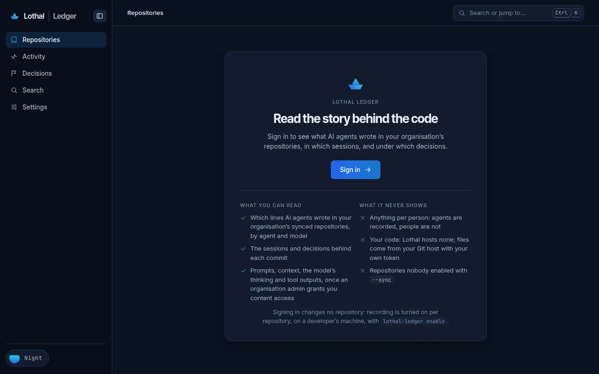
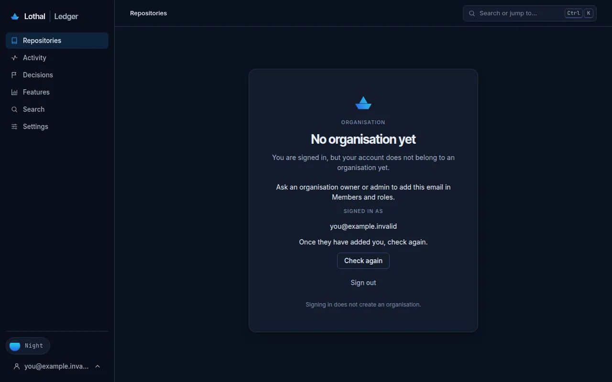
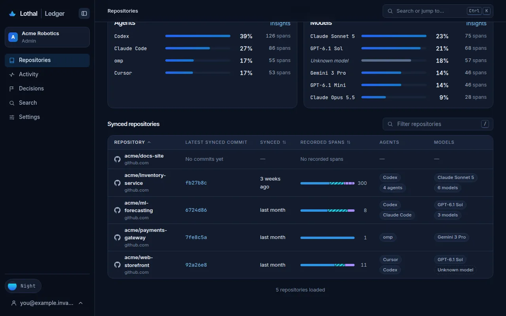
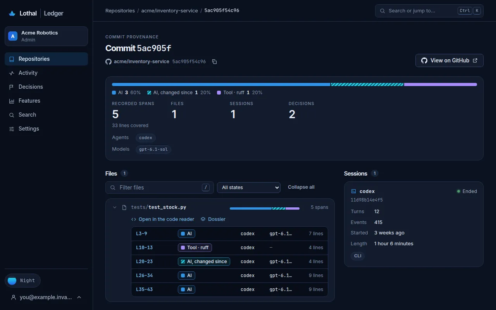
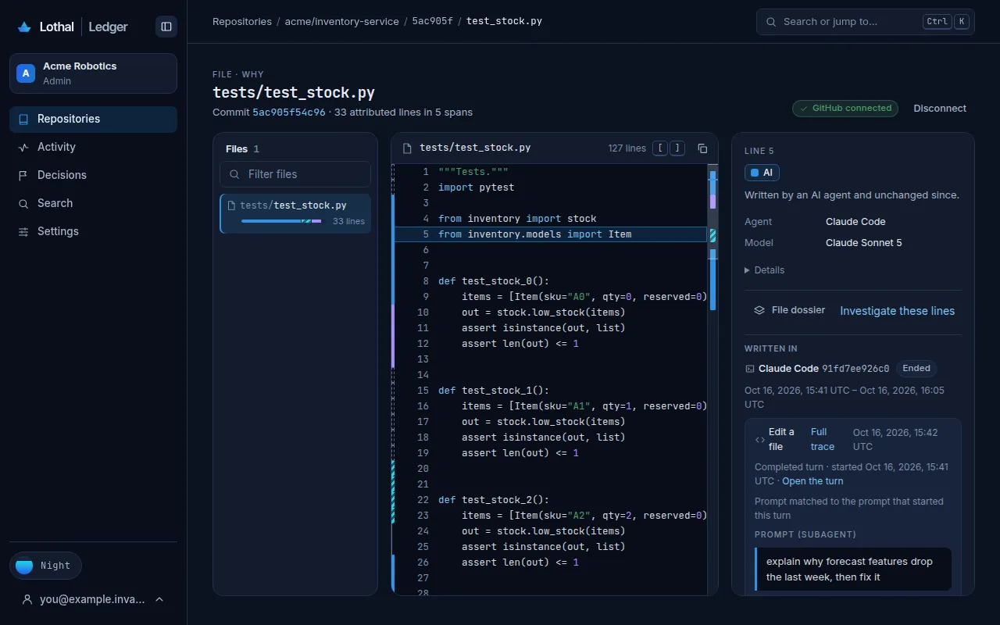
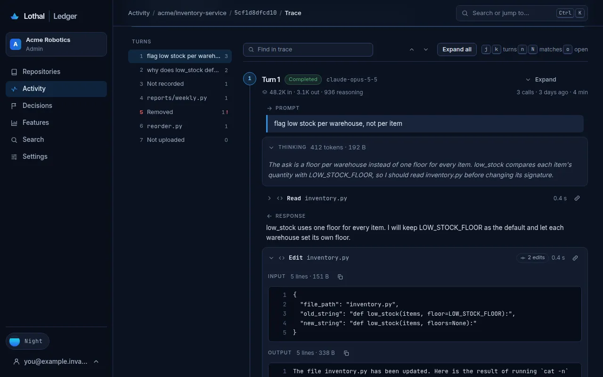
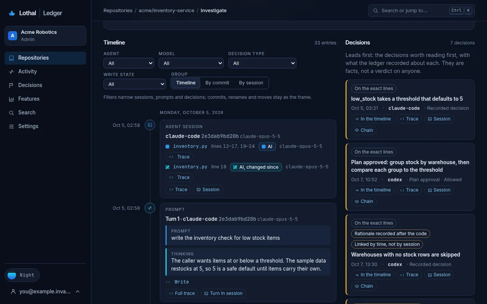
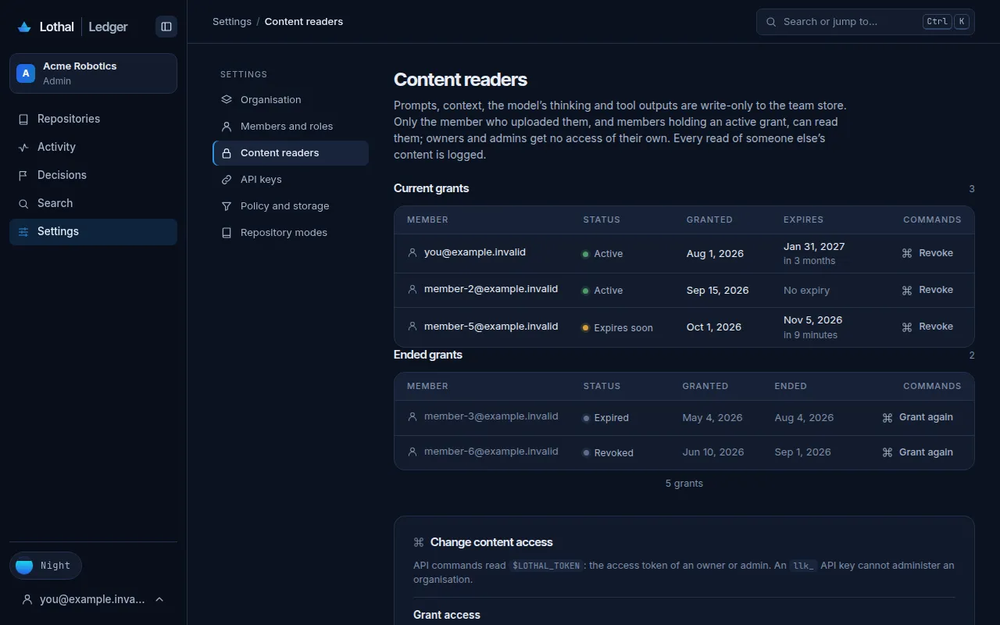
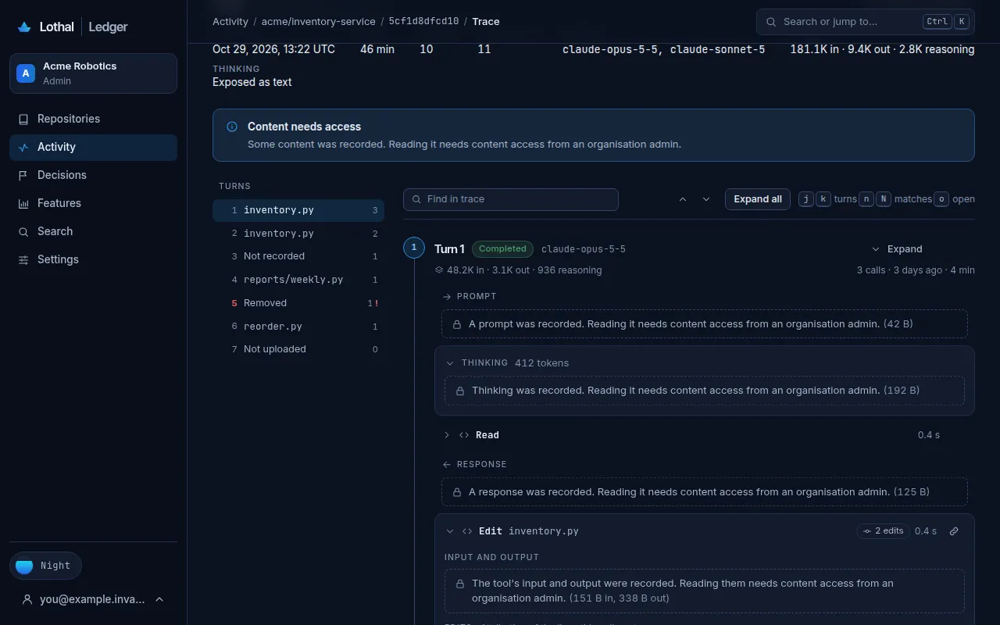

# On the web

The team platform's web app, at `https://app.dev.lothal.app` for the alpha, shows what your organisation's `sync` repositories uploaded: which lines AI agents wrote, in which sessions, how each agent got there, and what was decided. You need no CLI and no checkout to read it: a browser and a member's sign-in are enough.

The web app only reads. It changes no repository and records nothing: a repository appears there after a developer enabled it with `lothal-ledger enable --sync` on their machine and it uploaded while signed in ([Sign in and sync](login-and-sync.md)). It hosts none of your code either: the code reader fetches a file from GitHub in your browser, with your own token.

The screenshots on this page show example data, not a real team: the made-up organisation Acme Robotics, its `acme/*` repositories and placeholder members at `example.invalid`.

## Sign in

Open the app. Signed out, every page shows the sign-in page, which says what you can read and what it never shows. Choose **Sign in**, sign in with your organisation's account and you come back to the page you asked for, so a link a teammate sent you works the same way.

If your account belongs to no organisation yet, every page says **No organisation yet** and shows the email you signed in with. Ask an owner or admin of your organisation to add that email in **Members and roles**, then choose **Check again**. `Signing in does not create an organisation.`

- If you belong to several organisations, the organisation's name at the top of the side bar switches between them.
- **Search or jump to…** (Ctrl K) is the command palette: a repository, a page, a session's trace, or a search of session text. The side bar's shortcuts are shown beside each item (`g r` for Repositories, `g a` Activity, `g d` Decisions, `g s` Search, `g ,` Settings); **Keyboard shortcuts** in your account's menu lists the rest.
- **Collapse sidebar**, the button beside the Lothal name (or Ctrl B, ⌘B on a Mac), shrinks the side bar to a strip of icons; hover over an icon to see its name, and press the button again to bring the side bar back. The browser remembers your choice.
- The panes of the code reader (the files and the line panel), the trace (its turns) and an investigation (its decisions) are as wide as you want them: drag the edge between two panes, or click it and use the arrow keys. Double-click the edge, or press Enter on it, to go back to the usual width. The browser remembers the widths.

## From a repository to why a line exists

1. **Repositories** lists each synced repository with its latest synced commit, its recorded spans, and its agents and models; **Insights** adds the totals by state, agent and model. A span is a line range with a recorded writer: lines nothing recorded have none, so the counts are not shares of all code.

   

2. Open a repository. **Commits** lists its synced commits, newest sync first (the time is when the commit synced, not when it was made), 50 at a time with **Load more**. Each row shows the commit's subject (the first line of its message), its agents and models and its sessions as chips: click a session chip to open that session. When a group does not fit, its badge gives the total, including the visible chips, such as **4 agents**, **6 models** or **6 sessions**, not just the remainder. Hover over or focus the badge to read the names not shown; the repository list uses the same badges. A commit synced before its message was captured has no subject, so its row reads its short SHA instead. Drag the edge of a column header (or focus it and use the arrow keys, Shift for larger steps) to resize the Agents, Models, Sessions and Synced columns; the Commit column takes the rest. Your widths stay in this browser, and **Reset columns** restores the defaults. The other tabs are **Sessions**, **Decisions** and **Insights**.
3. Open a commit. **Commit provenance** shows what AI wrote in it under its subject and the rest of its message: the lines by state (`AI`, `AI, changed since`, `Tool`), each file with its attributed spans (lines, state, agent, model), the decisions linked to the commit and its sessions.

   

4. Choose **Open in the code reader** on a file. **Create a fine-grained token on GitHub** opens GitHub's token form with the repository's owner selected as **Resource owner**, **Contents: read**, and a 30-day expiration. Under **Repository access**, choose **Only select repositories** and select this repository: repositories cannot be prefilled by the link. An organization may need to approve the token before it can read private repositories. Paste the token and choose **Connect**: it stays in that browser tab, is never sent to Lothal, and **Disconnect** forgets it. Without a token you still see the file's attributed ranges.
   If the code reader says **Not found on GitHub**, GitHub hides private repositories from tokens that cannot read them, so a 404 does not necessarily mean the file is missing. Check that the token's **Resource owner** is the owner shown in the repository's remote (the organization for an organization repository, not your personal account), **Repository access** includes this repository, and it has **Contents: read**. Check whether organization approval is pending. The file may also be missing at the selected commit. The same access checks apply when GitHub refuses the token.
   The reader tells the other 404s apart by asking GitHub, with the same token, whether it has the commit. **Commit not on GitHub** means GitHub can read the repository but does not have this commit: the ledger records local commits too, so it may not be pushed yet, or it was amended or rebased away. A new token will not help; push the commit, or open one GitHub has. **File not in this commit on GitHub** means GitHub has the commit but the file is not in it there.
5. Click a line (or move with `j` and `k` and press Enter). The panel beside the code answers **Why is this line here?**: the line's state, agent and model, the session and call that wrote it (named by what it did, for example **Edit a file**, with the agent's own tool name in the tooltip and the hook event, turn id and call id under **Details**), the turn and its prompt (**Prompt (subagent)** when a subagent wrote it, then **Delegated by** each session that handed it the work, with the call that started it and that turn's prompt), **What the model saw** for that call, the decisions about the file, and the other sessions of the commit. From there, **Full trace** opens the session's trace at the call that wrote the line, **File dossier** opens the file's dossier, and **Investigate these lines** opens an investigation.

   

## The session and its trace

A session's page (from a session in the line panel, a commit, **Activity** or a repository's **Sessions** tab) shows when it started and how long it ran, its turns with each turn's prompt, calls and the lines they wrote, the subagents it started, its tokens by model, the commits it is linked to and its decisions.

**Full trace** shows the whole session, turn by turn in time order. The overview says how much of the model's thinking the agent exposes (`Exposed as text`, `Summaries only`, `Recorded, not readable`, or `Not exposed by this agent`); the list of turns beside it jumps to a turn. Each turn holds, in order:

- the prompt;
- the model's thinking, with its tokens and size;
- the model's responses;
- each tool call, named by what it did ("Read a file", "Run a command"; the agent's own tool name is in the tooltip), with its input and output, **Files read and context** (what the model saw when it made the call) and **Edits** (the lines the call wrote, with their state). An input or output the agent recorded as named arguments reads as those arguments, one per row; **Raw** shows it as recorded, and the copy button always copies it as recorded;
- a subagent the call started: **Show its trace** opens it in place, **Open full trace** on its own page;
- model changes and context compactions.

**Exchanges**, beside **Full** in the trace's bar, keeps what a reader follows: the prompts, the responses, the calls that edited, deleted or moved files or switched modes, the calls that wrote lines, the failed calls, the subagents, the agent's questions to you (**Question**) and the decisions it recorded (**Decision recorded**). Everything else between them reads as one line of counts, such as `… 4 calls (Read 3, Bash 1), 2 thinking`; **Show in full trace** opens the full trace at that point. The view is part of the page's address, so a link to it opens in the same view, and switching views keeps the turn you are reading.

**Expand all** and **Collapse all** open and close every block; each block can be hidden on its own, and **Link to turn** and **Link to this call** are links to share. A long field shows its first 16 KiB with **Show all** and its full size, which loads the whole field. A long session comes a page at a time (at most 50 turns or 1,000 blocks); **Load more turns** loads the next. **Find in trace** searches the turns loaded so far (**Load every turn** widens it to the whole session), and `n` and `N` move between matches.

## Investigate lines

In the code reader, click a line and Shift-click another (or hold Shift and move with the arrow keys): the bar above the code says which lines are selected and offers **Investigate lines …**. An investigation also starts from **Investigate these lines** in a line's panel, **Investigate this symbol** on a chain, an issue reference on a decision, or **Investigate a bug** in the palette, which asks for a repository, a target (lines, a symbol, files or an issue reference) and a range (all synced history, a commit range or a time window).

The answer is everything recorded about those lines across the team's sessions:

- **First, the decisions**, the leads worth reading first, each with how it is tied to the lines (on the exact lines, linked by time rather than by a session, a rationale recorded after the code) and links to the decision in the timeline, the trace, the session and the chain.
- **Then the timeline**, in time order: the agent sessions and the lines they wrote, each turn's prompt and thinking, the commits with the target lines' state at each, the decisions, and the renames and moves the lines went through. Filters narrow it by agent, model, decision type and write state; it can also be grouped by commit or by session. Each entry links into its trace (**Trace**, **Full trace**, **Turn in session**) and each commit to **Why at this commit**.

**Copy link** gives the investigation's permanent link. **Export Markdown** gives the timeline as Markdown for an issue or pull request comment, to copy or download; prompts, thinking and rationale are linked there, never copied.

## A function's dossier and chain, and the context of a call

- **The dossier** (**Dossier** beside a file on a commit, **File dossier** in a line's panel) is the card of each function and class in the file: its lines by state, the session that first wrote it, what the model saw then, its sessions, and links to its **Chain** and its lines in the code reader.
- **The chain** is one function's history across sessions, in time order: each session that wrote it and its writes, the decisions about it, and its renames and moves, filtered by **Sessions**, **Decisions** or **Renames and moves**. It lists the first entry and the newest, up to 200, and counts the ones between.
- **The context of a call**, what its model had been given, is **What the model saw** in a line's panel and **Files read and context** under each call in the trace: how completely it was captured (exact, partial or not captured), then each item by source (files, searches, shell output, MCP results, …) with its size.

## Decisions, search and sessions

- **Activity** lists every session synced to the organisation, filtered by agent, model and state, with the subagents and continued sessions each one has.
- A session that started subagents has a chevron before its name (**Show 2 subagents of …**, and **Hide …** once open) in the repository's **Sessions** tab and in **Activity**: press it, or focus it and press Enter or Space, to show the subagents under their parent, each level opening the same way. A level lists some subagents at first; **Show more subagents** reads the next ones, and **Try again** appears when they could not be read. On a session's page the subagents card has the same toggles per level, and **Expand all** opens every level.
- **Decisions** is the log of what agents and people decided while the code was written: recorded decisions, permission outcomes and plan approvals, filtered by kind, type, outcome, actor, timing and how each is linked. A decision an agent recorded with `record_decision` says where: **Recorded in** the session (its name, else the agent and a short hash), **turn N**, **call** and its id, and the line opens the trace at that call. The log's **Link** filter offers **Recorded-call link** for these decisions. The same line is on the decision in a session's page, in an investigation, on a commit's page, in a line's panel and on a file dossier's cards. A question an agent asked the person reads as a **Question**, **Answered**, **Unanswered** or **Cancelled**, with its summary (for example `question answered: ask`); **Type** and **Outcome** filter on them. If you can read the session's content you also see each question, what was picked and what else was offered (`Q: Which greeting?  selected: Hi  · also offered: Hello | Hey`), and what the person typed; in a line's panel, a question asked by the session that delegated the work says **asked in** that session. Open one for its rationale, the code it names, its issues (each with **Investigate**), its session with **Full trace**, and its commits. An AI-derived decision shows only `An AI-derived decision was recorded. It stays restricted until a person publishes it.`
- **Search** finds words in the prompts, answers and tool narration you can read, each hit with its session.

## Settings and signing out

**Settings** is about the organisation, and only reads: `Settings are read-only on the web: each change shows the exact command that makes it.` Each change is a command to copy, which needs the access token of an owner or admin; an API key cannot administer an organisation.

- **Organisation**: its name and ID, your role, and the counts of members, repositories, content readers and API keys, with the command that signs a machine in to this organisation.
- **Members and roles**: each member and role, for owners and admins, with the commands to add a member and, per member, to grant content access (for 90 days).
- **Content readers**: the current and ended content access grants, with the command that revokes each.
- **API keys**: the organisation's keys for CI and the pull-request check (`llk_…`), when each was created and last used, and the commands to create and revoke one. A new key is shown once.
- **Policy and storage**: the minimum redaction version uploads must have passed, and how much of the content storage cap is used.
- **Repository modes**: what `local` and `sync` mean, and the commands that connect a repository. Only `lothal-ledger enable` and `disable`, run in the repository, change its mode; nothing on the web does. The page's **Content none** card describes a mode `enable` does not have: an ignore rule keeps content out ([Keep content out](enable-and-modes.md#keep-content-out)).

To sign out, open your account's menu at the top right and choose **Sign out**. Signing out of the web stops no recording and uploads nothing; a machine signed in with `lothal-ledger login` stays signed in until `lothal-ledger logout` runs there.

## What you see without content access

Prompts, thinking, responses, tool inputs and outputs and context arguments are content: you read what you uploaded, and anyone else's only while an organisation admin grants you content access ([Privacy](privacy.md#who-reads-what-you-uploaded)). The trace says which you are. With access:

> You can read this session’s content. Reads of content someone else uploaded are logged.

Without it, the trace's overview says `Some content was recorded. Reading it needs content access from an organisation admin.`, and each field shows that it was recorded and how big it is, never its text (the sizes here are examples; a line's panel, the session page and an investigation use the same sentences):

| Field | You see |
|---|---|
| Prompt | A prompt was recorded. Reading it needs content access from an organisation admin. (42 B) |
| Thinking | Thinking was recorded. Reading it needs content access from an organisation admin. (192 B) |
| Response | A response was recorded. Reading it needs content access from an organisation admin. (125 B) |
| A tool call | The tool's input and output were recorded. Reading them needs content access from an organisation admin. (29 B in, 360 B out) |
| What the model saw | The arguments were recorded. Reading them needs content access from an organisation admin. 3 items · 93 B |

Search covers only what you can read: `Content you cannot read is never searched or counted`, so no search hints at what you may not read. Where content was not kept, or not uploaded, the page says why in the same words as everywhere else ([Privacy](privacy.md#what-you-see-instead-of-the-text)); a write no prompt could be tied to says `No prompt was tied to this call.`

## Nothing is per person

Every page is about the code, the agents and the models, never the people. Sessions are named by their agent and model, the totals are by repository, agent and model, and no page counts, ranks or filters anyone's activity; the sign-in page puts it as `Anything per person: agents are recorded, people are not`. The member list exists for access administration only, and only owners and admins see it: `Access administration only: Lothal keeps no activity, counts or metrics per person.`

Next: [Troubleshooting](troubleshooting.md).
